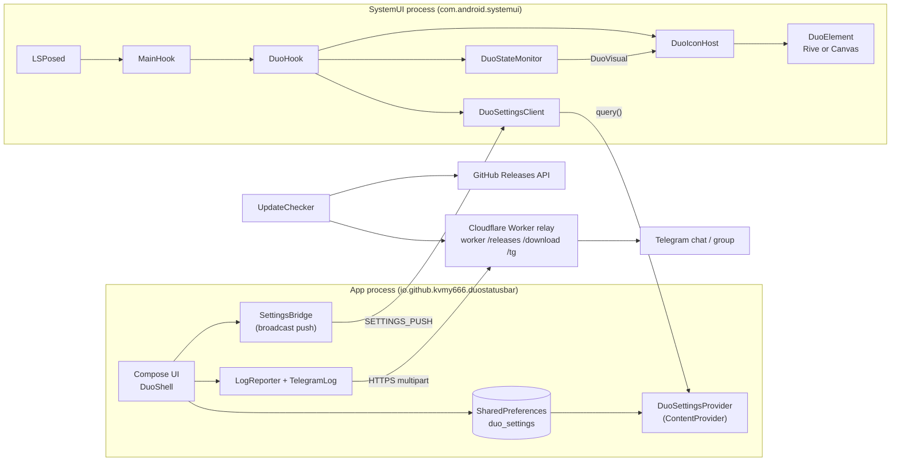
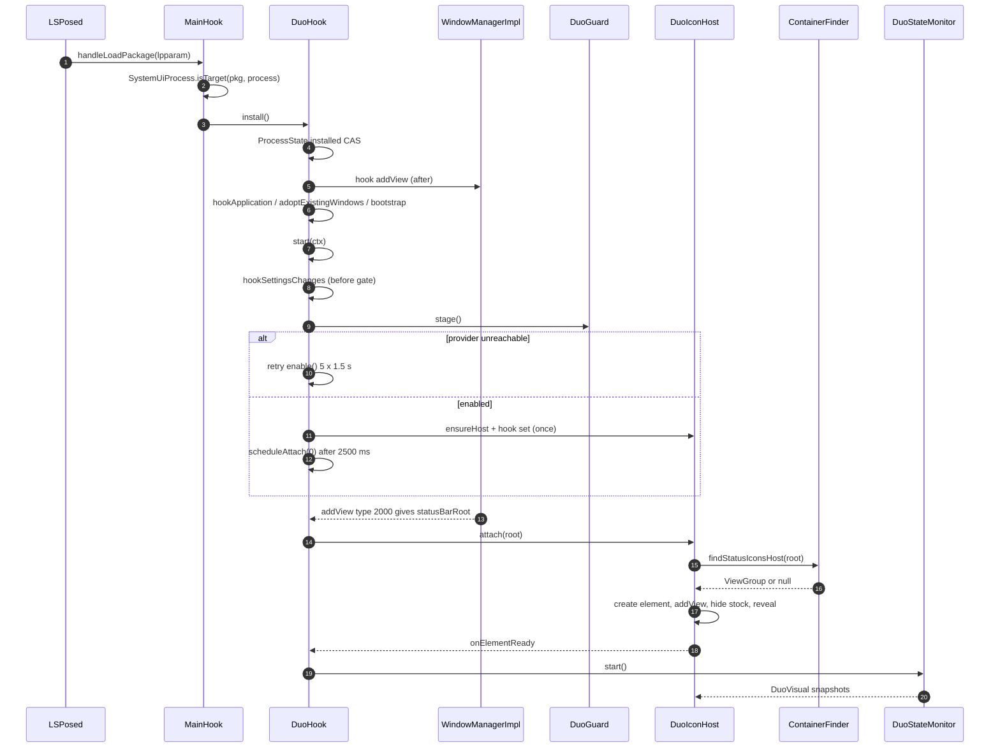
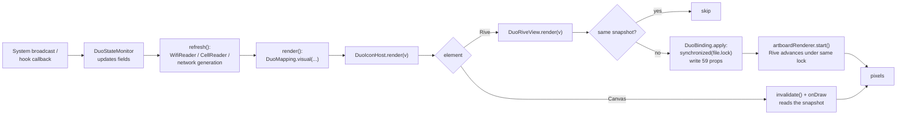
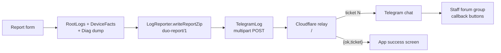
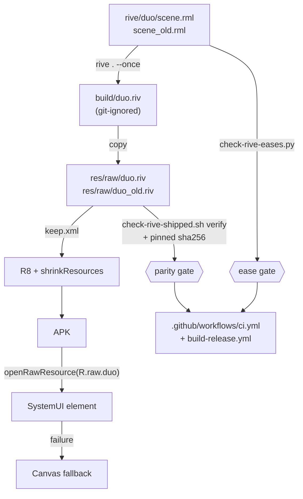

# Duo Status Bar — Architecture

**Current as of 2.0.2 (versionCode 102).** Generated 2026-11-19; citations checked against the current worktree at HEAD `4275ebf` (2.0.2) plus the pending index/worktree edits shown by `git status` (`app/build.gradle.kts:47-48`). Line citations into the 24 files touched by the staged dead-code pass are re-synced to the index (post-pass).
**Audience:** a developer new to the code. Read `AGENTS.md` and `agent/AGENTS-V2.md` first; this document explains *how the code is put together*, not the release process.
**Path convention:** every `path:line` below is repo-relative (for example `app/src/main/java/...`). Quotes are exact excerpts from the cited line unless marked otherwise. Claims that could not be checked are marked **UNVERIFIED**.

**Contents:** [1. What this is](#1-what-this-project-is) · [2. Component map](#2-component-map) · [3. Attach sequence](#3-attach-sequence-lsposed-load--first-pixel) · [4. ROM adapters](#4-rom-adapter-and-measured-profiles) · [5. Rendering](#5-rendering) · [6. State and data](#6-state-and-data-flow) · [7. Companion app](#7-companion-app) · [8. Failure matrix](#8-failure-and-fallback-matrix) · [9. Threading](#9-threading-model) · [10. Build and CI](#10-build-ci-tools-and-the-rive-pipeline) · [11. Where to change X](#11-where-to-change-x) · [12. Invariants](#12-invariants-a-new-developer-must-not-break) · [13. Known gaps](#13-known-gaps-and-open-questions)

---

## 1. What this project is

Duo Status Bar is an **LSPosed module** that runs inside the Android `com.android.systemui` process and replaces the stock battery / Wi-Fi / mobile-signal icons with a single animated element (Rive scene, with a Canvas fallback). A **companion app** writes settings, draws a live preview, collects diagnostics and uploads reports; a **Cloudflare Worker relay** forwards reports to Telegram so no bot token ships in the APK.

It does not modify system files. It hides only the icons it replaces and draws one view (`README.md:7-11`).

### 1.1 Runtime topology



The app and the module never share a process. They share (a) a ContentProvider row, (b) signature-permission broadcasts, and (c) files under the app's `FileProvider` (`AndroidManifest.xml:47-63`, `settings/SettingsBridge.kt:23-40`).

---

## 2. Component map

All source is under `app/src/main/java/io/github/kvmy666/duostatusbar/` unless stated.

| Layer | Files | Responsibility |
|---|---|---|
| Entry | `MainHook.kt`, `SystemUiProcess.kt`, `assets/xposed_init` | LSPosed entry, process gate, one top-level try/catch |
| Hook install | `hook/DuoHook.kt`, `hook/ProcessState.kt`, `hook/AppContextResolver.kt` | Install window/application/vendor hooks, adopt an existing window, schedule attach, receive settings/restart/diagnostics actions |
| Host | `hook/DuoIconHost.kt`, `hook/ContainerFinder.kt`, `hook/StockIconHider.kt`, `hook/PanelHandoff.kt`, `hook/SlotGeometry.kt` | Resolve the strip, add the view, hide replaced stock icons, place/seat it, hand off between panels and bars |
| Render abstraction | `hook/DuoElement.kt`, `hook/DuoPart.kt` | Interface implemented by Rive and Canvas; ring/indicators/all parts |
| Rive | `RiveInit.kt`, `hook/DuoRiveView.kt`, `hook/DuoBinder.kt`, `hook/DuoGuard.kt` | Native bootstrap, view/state-machine lifecycle, 59-property contract, crash breaker |
| Canvas | `hook/DuoCanvasView.kt` | Fallback drawing of the same element |
| Geometry | `hook/RingGeometry.kt`, `hook/SlotGeometry.kt`, `hook/ElementHitGeometry.kt` | Pure arc/seat/size math |
| State | `hook/DuoStateMonitor.kt`, `hook/WifiReader.kt`, `hook/CellReader.kt`, `hook/SignalMapping.kt`, `hook/DeviceStateReader.kt`, `hook/SystemReaders.kt`, `hook/ClockFontController.kt`, `hook/BarTint.kt` | System event sources and readers |
| Mapping | `hook/DuoMapping.kt`, `hook/DuoVisual.kt`, `hook/Colors.kt` | Turn readings into one immutable visual snapshot |
| Settings (module) | `hook/DuoSettingsClient.kt`, `settings/StageOverride.kt` (app) | Read the provider, bridge fallback, retry, stage gate |
| ROM | `hook/rom/RomAdapter.kt`, `hook/rom/RomProfiles.kt`, `hook/rom/RomResources.kt`, `assets/rom-profiles.json` | Per-ROM ids, measured/static profiles, id lookup |
| Events/integration | `hook/events/LiveEvent.kt`, `hook/events/EventArbiter.kt`, `hook/integration/AutoExpand.kt`, `hook/OnePlusShadeHooks.kt`, `hook/ScreenshotWatcher.kt`, `hook/DownloadProgress.kt`, `hook/DownloadWash.kt` | Live event arbitration, vendor shade hooks, screenshot/download sources |
| Motion | `hook/ChargeMotion.kt`, `hook/DotMoonMotion.kt`, `hook/BurnIn.kt`, `hook/ElementGestures.kt` | Renderer-neutral motion numbers |
| Diagnostics | `hook/Diag.kt`, `hook/HookReporter.kt`, `hook/DuoLog.kt`, `hook/LogOnce.kt`, `L.kt` | Diagnostic dump, status/DUMP/FALLBACK pushes, structured logs |
| App UI | `MainActivity.kt`, `DuoApp.kt`, `DuoPreview.kt`, `ui/DuoShell.kt`, `ui/DuoHomeScreen.kt`, `ui/DuoSettingsScreen.kt`, `ui/DuoSettingsSections.kt`, `ui/DuoReportScreen.kt`, `ui/GlassSurface.kt`, `ui/GlassControls.kt` | Four-tab shell, preview, settings, report form |
| App settings | `settings/DuoPrefs.kt`, `settings/DuoSettingsProvider.kt`, `settings/SettingsBridge.kt`, `settings/BackupCodec.kt`, `settings/StageOverride.kt`, `settings/DuoActions.kt` | Schema/defaults, provider row, bridge, backup, stage override, Auto Expand vocabulary |
| App support | `settings/ModuleHealth.kt`, `settings/StockIconInventory.kt`, `settings/StockIconHider.kt`, `settings/IconBlacklist.kt`, `settings/UpdateChecker.kt`, `settings/UpdateWorker.kt`, `settings/UpdateDownloadWorker.kt`, `settings/UpdateDownloadReceiver.kt`, `settings/UpdateNotifications.kt`, `settings/ShellService.kt` | Health, stock-icon inventory/hiding, updates, Shizuku shell |
| App report | `ui/DuoReport.kt`, `ui/LogReporter.kt`, `settings/TelegramLog.kt`, `RootLogs.kt`, `RootProbe.kt`, `DeviceFacts.kt` | ZIP schema, root capture, upload |
| Rive source | `rive/duo/scene.rml`, `rive/duo/scene_old.rml`, `rive/duo/rive.yaml` | Authored scenes (new + Classic) |
| Shipped assets | `app/src/main/res/raw/duo.riv`, `duo_old.riv`, `keep.xml`, `assets/rom-profiles.json`, `assets/xposed_init` | Binaries and packaging rules |
| Relay | `relay/src/index.js`, `relay/wrangler.toml` | Report upload, ticket counter, release feed/download, Telegram webhook |
| Support bot | `report-bot/` | Third-party Telegram support bot (separate from the relay; see §7.6) |
| Tools | `tools/*.py`, `tools/build-rive-both.sh`, `tools/check-rive-shipped.sh`, `tools/duo-verify.ps1` | Static gates and owner-run device verification |

---

## 3. Attach sequence (LSPosed load → first pixel)

### 3.1 Numbered flow

1. **LSPosed reads the entry point.** `assets/xposed_init:1` = `io.github.kvmy666.duostatusbar.MainHook`; the manifest declares `xposedmodule=true`, `xposedminversion=82`, scope `com.android.systemui` (`AndroidManifest.xml:124-141`).
2. **`MainHook.handleLoadPackage`.** Logs package/process, checks `SystemUiProcess.isTarget`, logs SELinux/ABI/SDK, then constructs `DuoHook(lpparam).install()` inside a `try/catch` (`MainHook.kt:16-34`). The whole body is guarded; a failure never touches the bar.
3. **Process gate.** `isTarget` is `packageName == "com.android.systemui" || processName == "com.android.systemui"` (`SystemUiProcess.kt:17-20`). The process-name branch exists because HyperOS reports `packageName="system"` (registry **M4**; `SystemUiProcess.kt:6-10`).
4. **`DuoHook.install()` order** (`DuoHook.kt:157-180`):
   - duplicate-load gate `ProcessState.installed.compareAndSet(false, true)`;
   - version banner;
   - `hookWindowManagerAddView()` **before** any application hook (registry **M3**; comment at `DuoHook.kt:167-171`);
   - `hookApplication()` on `android.app.Application`, `com.android.systemui.SystemUIApplication`, `com.android.systemui.MiuiSystemUIApplication`;
   - `adoptExistingWindows()` (late injection);
   - `startWithCurrentApplication()` and `bootstrap()` (retrying context resolution).
5. **Window discovery.** The `android.view.WindowManagerImpl.addView` **after**-hook reads the new view's layout-param `type`: `2000` (`TYPE_STATUS_BAR`) stores `statusBarRoot` and calls `scheduleAttach(0)`; `2040` (`TYPE_NOTIFICATION_SHADE`) is adopted as the shade window (`DuoHook.kt:533-557`; constants `AppContextResolver.kt:13-16`). The hook itself never calls `addView`; `DuoIconHost.attach` does (`DuoIconHost.kt:2984`).
6. **`start(ctx)`.** CAS `ProcessState.started`, store `app`, then **register the settings receiver before the enable gate** (registry **M11**) and call `enable(ctx, 0)` (`DuoHook.kt:275-288`).
7. **`enable(ctx, attempt)`.** Resolve `stage` (`DuoGuard.stage()`). If stage is `0` but the provider was unreachable, retry up to 5 × 1.5 s (registry **C11**). If off in both orientations, stop. Otherwise: create the single `DuoIconHost`, install the once-only hook set, and call `scheduleAttach(0)` (`DuoHook.kt:296-356`; constants `:1161-1162`).
8. **Attach retry.** `scheduleAttach` waits `FIRST_DELAY_MS = 2500 ms`, then retries every `RETRY_MS = 2000 ms` up to `MAX_ATTEMPTS = 6` (`DuoHook.kt:608,1139,1153-1154`). On exhaustion it sends a diagnostic dump and leaves the stock bar untouched (`:561-573`).
9. **`DuoIconHost.attach(root)`.** Resolve the strip via `ContainerFinder`, choose a parent (plain `FrameLayout` overlay when the vendor container would not lay out injected children — **C7**), create the element (Rive if allowed, else Canvas), `container.addView`, then `onReady` hides the replaced stock icons, hides the overlay anchor, applies layout and reveals (`DuoIconHost.kt:2903-3012,3015-3043`). Before any stock icon is hidden, 2.0.2 validates the attach: `onElementReady` rejects a 0×0 or wrongly-parented candidate, `verifyAttachedBox`/`ensureCanvasBox` retry for 6 frames, and the visibility/hiding paths restore stock rather than hide under a non-drawing Duo (`DuoIconHost.kt:3015-3021,3094-3131,999-1004,3231-3244`).
10. **Start the state monitor.** Only after a successful attach: `monitor = DuoStateMonitor(ctx, host!!).also { it.start() }`; install the layout listener, extra bars (keyguard/shade header), the touch hook, and report status (`DuoHook.kt:583-603`).

### 3.2 Sequence diagram



### 3.3 Hook inventory

Installed by `DuoHook` after the stage gate (except the window/application hooks in `install()`). Names are the measured targets, not guesses.

| Target | Callback purpose | Evidence |
|---|---|---|
| `android.view.WindowManagerImpl.addView` | Discover status-bar and shade windows | `DuoHook.kt:533-557` |
| `Application.onCreate` (3 classes) | Start on a live SystemUI process | `DuoHook.kt:358-385` |
| `ShadeHeaderController` constructors + `ViewStub.inflate` | Shade header surface | `DuoHook.kt:1069-1136` |
| `NotificationShadeWindowControllerImpl.onShadeOrQsExpanded(Boolean)` | Shade/QS visibility | `DuoHook.kt:698-844` |
| `ShadeExpansionStateManager.onPanelExpansionChanged(F,Z,Z,String,PanelType)` | Panel expansion → hand-off | same |
| `StatusIconContainer` / `MiuiStatusIconContainer.addView` | Watch the strip for re-adds | `DuoHook.kt:939-964` |
| `StatusBarIconView.onDarkChanged` / `setIconColor` | Bar tint | `DuoHook.kt:974-996` |
| `FlashlightControllerImpl.dispatchListeners(int,boolean)` | Flashlight event | `DuoHook.kt:998-1017` |
| `TakeScreenshotExecutorImpl.executeScreenshotsAsync` | Screenshot event | `DuoHook.kt:1019-1035` |
| `StatusBarKeyguardViewManager.notifyKeyguardAuthenticated` / `onKeyguardFadedAway` | Unlock event | `DuoHook.kt:1037-1067` |
| Vendor OnePlus QS/simple/split headers | OxygenOS shade hand-over | `hook/OnePlusShadeHooks.kt` |
| bar-root `dispatchTouchEvent` | Tap/double-tap/long-press | `DuoHook.kt:623-650` |
| `DisplayManager.registerDisplayListener` + component callbacks | Rotation/orientation | `DuoHook.kt:456-479` |

Every hook is wrapped in `L.guard`, which is `try/catch + L.e` (`L.kt:125-131`). Delta of a hook that is absent on a ROM: log a `HOOK_ABSENT` event (or `PANEL_HOOK_ABSENT` for the panel hook) and continue (`DuoHook.kt:752-761,833-842`).

---

## 4. ROM adapter and measured profiles

### 4.1 Detection

`RomDetection.forThisRom(manufacturer, brand, product, display, api)` lowercases the four values and returns the first matching adapter in this order: Samsung, OnePlus/OxygenOS, OPPO/ColorOS, Xiaomi/HyperOS, vivo/iQOO, Honor, Motorola, Nothing, else AOSP (`hook/rom/RomAdapter.kt:80-103`).

Each `RomAdapter` carries `containerIds`, `batteryId`, `clockId`, shade ids, and the SDK gate for measured profiles, `apiMin`/`apiMax` (`hook/rom/RomAdapter.kt:15-70`). OxygenOS is measured on SDK 36, and on the legacy/test wildcard `api == 0` (`:153,162`); HyperOS is measured on SDK 37 and on the same wildcard (`:248,264`). On any other real SDK they report `measured=false` and say so in an `unverified` note (`:160-161,261-262`). Every other adapter carries an `(unverified)` label (`:183,215,280,299,315,331`).

### 4.2 Asset profiles

`assets/rom-profiles.json` has `version: 2` and nine profiles; only `oxygenos` and `hyperos` have `"measured": true`, and each carries its per-profile SDK range (`assets/rom-profiles.json:2,20-22,53-55`). `RomProfiles.load` reads the asset through the **module package context** after trying the host context (registry **M16**; `hook/rom/RomProfiles.kt:32-45,57-63`), parses defensively (including `apiMin`/`apiMax` at `:85-86`), and returns an empty list on any error (`:66-102`).

There are two code-only/profile-aware forms:

- Code-only selection: `forThisRom(manufacturer, brand, product, display, api)` (`hook/rom/RomAdapter.kt:80-103`).
- Profile-aware selection: `forThisRom(manufacturer, brand, product, display, profiles, api)` (`:111-125`), plus a convenience overload that takes the SDK before the profile list (`:131-138`). A profile wins only when `profile.measured && apiInRange(profile.apiMin, profile.apiMax, api) && profile.match.any { haystack.contains(it.lowercase()) }` (`:120-122`). `api == 0` is the legacy/test wildcard — any SDK (`:143-144`).

Who uses which: `DuoIconHost` builds its adapter with the profile-aware overload and `RomProfiles.load(context)`, passing `Build.VERSION.SDK_INT`, so measured profiles drive runtime attachment only inside their SDK range (`hook/DuoIconHost.kt:397-405`). `Diag` does the same (`hook/Diag.kt:77-85`), and `DuoHook`'s own early adapter also passes the SDK (`hook/DuoHook.kt:117-123`); that adapter is used only for its own resource-id probes (e.g. the shade-header id at `hook/DuoHook.kt:1119`), not for `ContainerFinder`. `ui/LogReporter.kt:262-268` calls the profile-aware overload **without** the SDK argument, so it falls back to the wildcard `api == 0` — a known divergence (§13). On an SDK outside the measured range the asset profile is rejected and the adapter reports `measured=false`; the element still attaches via the code adapter. Keep that in mind when a measured profile is added for a vendor that also has a code adapter.

### 4.3 Resource lookup

`RomResources.id(ctx, rom, name)` is the single `getIdentifier(name, "id", rom.systemUiPackage)` wrapper; `0` means "not on this ROM" (`hook/rom/RomResources.kt:12-16`). `ContainerFinder` probes adapter ids in order, skips `GONE` strips (**C6**), then falls back to a strip around the battery/status-icons anchors, then to a role scan (lowest common non-GONE ancestor of the status-icons host and battery) (`ContainerFinder.kt:48-112`).

---

## 5. Rendering

### 5.1 Renderer selection

`DuoElement` is the renderer-agnostic interface; `DuoRiveView` is the real element and `DuoCanvasView` is the fallback (`hook/DuoElement.kt:10-19`).

| Condition | Result | Evidence |
|---|---|---|
| `Settings.Global duo_statusbar_stage` present (0/1/2) | That value wins | `hook/DuoGuard.kt:60-64,82-89` |
| App `enabled=false` | Stage 0, nothing injected | `DuoGuard.kt:66-69` |
| `engineMode == ENGINE_CANVAS` or `useRive=false` | Stage 1 → Canvas | same |
| Otherwise | Stage 2 → Rive, subject to the breaker | `DuoGuard.kt:69` |
| Stage 2 + `riveAllowed()` false | Canvas + fallback report | `DuoIconHost.kt:3167-3170` |
| Stage 2 + `RiveInit`/asset/instance failure | Canvas | `DuoIconHost.kt:3173-3179` (clean start failure); `:3049-3074` (late-bind Canvas fallback) |

`DuoIconHost.attach` enters with `guard.stage()` (`DuoIconHost.kt:2903-2906`); `riveElement()` checks hardware acceleration first, then `riveAllowed()`, records the attempt **before** constructing the view, and hands the attempt back on a clean start failure (breaker counts deaths, not clean errors) (`DuoIconHost.kt:3161-3181`).

### 5.2 Native bootstrap (`RiveInit`)

`RiveInit.ensure` is idempotent (`@Volatile` + double-checked lock), catches `Throwable`, and caches `false` (`RiveInit.kt:49-66`). It does three things instead of calling the library initialiser:

1. `System.load(<absolute .so path>)` for every library in the **module's** `nativeLibraryDir`, C++ runtime first (`RiveInit.kt:69-94`).
2. Pins `defaultRendererType = Canvas` reflectively (`RiveInit.kt:102-104`).
3. Calls `initializeCppEnvironment()` and verifies the type is non-null (`RiveInit.kt:106-112`).

Why (**C1**): the library's `ReLinker` path looks in SystemUI's package, throws, and leaves `defaultRendererType` null; the null reaches native `Renderer.make()` and SIGSEGVs SystemUI. `RiveInitializer` is deliberately never called (`RiveInit.kt:14-37`). A `false` result makes `DuoRiveView.start()` return false and the host use Canvas.

### 5.3 Rive view lifecycle (`DuoRiveView`)

| Step | Behaviour | Evidence |
|---|---|---|
| Resolve asset | `moduleContext.openRawResource(rawResourceFor(design))`, never by path (**M8**) | `DuoRiveView.kt:360-380` |
| Classic scene | `rawResourceFor` returns `R.raw.duo_old` for `DESIGN_OLD` (the default) and `R.raw.duo` otherwise; `OLD_OPTICAL_SCALE = 0.9286f` keeps the older 112 px art at the new 104 px size | `hook/DuoRiveView.kt:23-25`; `settings/DuoPrefs.kt:133,198-207,388`; `hook/SlotGeometry.kt:15-20` |
| Build | `RendererType.Canvas`, `setResource(bytes)`, artboard `"Duo"`, state machine `"Duo"`, `Fit.CONTAIN`, `Alignment.CENTER`, autoplay/bind, no CDN | `DuoRiveView.kt:148-160,385-386` |
| Size | Added `MATCH_PARENT`; size is owned by `SlotGeometry`, never resized by Rive (**C2**) | `DuoRiveView.kt:163`; `SlotGeometry.kt:29-33` |
| Start machine | Explicit `play("Duo", Loop.LOOP, …)` after binding; autoplay alone was not enough (**M1**) | `DuoRiveView.kt:196-202` |
| Bind instance | Poll `stateMachines.firstOrNull()?.viewModelInstance` for 100 ms × 25 | `DuoRiveView.kt:187-224,390-391` |
| Bind object | `DuoBinder.bind(found, file.lock)` — same lock the renderer advances under | `DuoRiveView.kt:197`; `DuoBinder.kt:19-32` |
| Draw | On each real snapshot: write props, `artboardRenderer.start()`, schedule idle stop | `DuoRiveView.kt:236-273` |
| Idle pause | `postDelayed(idleStop, 3000)`; stops the renderer when quiet (**C8**) | `DuoRiveView.kt:102-121,394` |
| Dedup | Identical `DuoVisual` + same part → no write, no wake | `DuoRiveView.kt:237` |
| Surface safety | `GuardedRiveView` drains the shared Canvas worker before surface release/resize | `DuoRiveView.kt:403-461` |
| Dispose | Remove callbacks, `rive.stop()`, remove views, null fields | `DuoRiveView.kt:332-352` |

### 5.4 The frozen Rive contract (`DuoBinder`)

`PROPERTY_COUNT = 59` (`hook/DuoBinder.kt:53`). Names exist once and are shared by the module view and the app preview (`DuoBinder.kt:9-12`); both Rive scenes must carry every name. Groups:

| Group | Properties | Evidence |
|---|---|---|
| Ring/trim | `trimLeftEnd`, `trimRightEnd`, `leftArc`, `rightArc`, `trackOpacity`, `percentFontSize`, `percentY` | `DuoBinder.kt:82-89` |
| Battery line | `batteryLineStart` | `DuoBinder.kt:91` |
| Middle/invert | `middleY`, `middleScale`, `boltY` | `DuoBinder.kt:93-96` |
| Parts/visibility | `ringOpacity`, `indicatorsOpacity` | `DuoBinder.kt:99-100` |
| Signal | `wifiLevel`, `cell1..4Opacity`, `moon1..4Opacity`, `moon1..4Scale`, `centerMoonOpacity`, `centerMoonScale`, `middleMode` | `DuoBinder.kt:103-122` |
| Download wash | `downloadLeft/RightEnd`, `downloadLeft/RightOffset`, `downloadOpacity`, `downloadGradientOpacity`, 5 stops + start/end points | `DuoBinder.kt:125-139` |
| Event | `eventType`, `eventVisible` | `DuoBinder.kt:140,170` |
| Colour | `tint`, `fgColor`, `downloadColor`, 5 gradient colours | `DuoBinder.kt:147-154` |
| Text | `percentText`, `networkText` | `DuoBinder.kt:160-162` |
| Flags | `visible`, `charging`, `animateCharge` | `DuoBinder.kt:164-168` |
| Reveal | `revealMs` (not counted in the 59) | `DuoBinder.kt:55,174-176` |

Write rules: each property is its own try/catch and a failure increments a counter (`DuoBinder.kt:178-184`); all writes are serialized under the Rive file lock to avoid `ConcurrentModificationException` during `advance` (`DuoBinder.kt:19-32,198`). The names are shared by the module view and the app preview (`DuoBinder.kt:9-12`). Parity is covered by `app/src/test/java/.../hook/RivePropertyParityTest.kt:67-101`, which asserts `scene.rml` and `scene_old.rml` carry the same property set, that every `DuoBinder` name exists in both, and that `PROPERTY_COUNT` matches.

### 5.5 Canvas fallback (`DuoCanvasView`)

Draws the same element from the same snapshot and geometry:

- Scale `width / RingGeometry.ARTBOARD_SIZE` (120); ring centre `height * 77.5 / 136` (`DuoCanvasView.kt:178-181`).
- Battery track and level line from `batteryLineStart` to `BATTERY_LINE_END`; no hard-coded full circle (**M13**) (`DuoCanvasView.kt:196-225`).
- Download wash with the same caps/offsets (solid or `LinearGradient`) (`:226-276`).
- DND crescent, Wi-Fi dot + arcs, 8 cell dots + moons + centre moon, network text, bolt and percent (`:278-390`).
- Event art only for alarm/flashlight/screenshot (`:184-190,486-553`).
- Angle convention: Canvas 0° = 3 o'clock; Rive trim 0 = 12 o'clock, so arcs add 270° (`:36,579`).

The fallback receives the same design style (`DuoCanvasView.kt:38-44`): in Classic it draws single-side dots and moons (`:305-321`), and `DuoIconHost.kt` wires the style through at `:3055,3147`.

It deliberately does not own Rive's arrival/depart, bolt flight, middle-slot morph or the airplane glyph (`DuoCanvasView.kt:28-34`). It does own the dot→moon fill (`DotMoonMotion.kt:24-66`), the charging settle pulse and a 500 ms flashlight ramp (`DuoCanvasView.kt:437-457,486-553`). `onDraw` catches everything and draws nothing rather than throwing every frame (`:164-171`). Every occupant the Rive path draws must exist here (**C9**, plus **M13** for the track).

### 5.6 Geometry ownership

| Concern | Rule | Evidence |
|---|---|---|
| Slot size | Base captured once at attach, before hiding stock; extras reuse the main bar's final side (**C2**, **M15**) | `SlotGeometry.kt:29-33,82-94,102-116` |
| Seat | Main ring is right-seated by default (`rightSeat = true`); `0` = physical right edge; the Camera/lock ring is a separate centered mode | `DuoIconHost.kt:2245`; lock/Camera `:2338-2341`; `SlotGeometry.kt:176-220` |
| QS seat | `anchorOnBattery(..., alignEnd = true)`; battery stays INVISIBLE with a real frame | `DuoIconHost.kt:1909-1912` |
| Shade header | The shade header uses `place(...)` with the `rightSeat = true` branch so it sits on the physical right like the main bar, with no shade-only clamp ("v89 seat" is the registry label, **M19**) | `DuoIconHost.kt:1913-1919`; `agent/AGENTS-V2.md:327` |
| Ring | Artboard 120 wide, height 136 (`ARTBOARD_SIZE + PERCENT_LIFT`), radius 51.5, stroke 8; dots at 115.5°/91.15°/67.4°/44.2° (documented on `CELL_DOT_POSITIONS`; the duplicate `CELL_DOT_ANGLES` constant was removed in the dead-code pass) | `RingGeometry.kt:95,174,98-133` |
| Battery line | `start = 0.6193 - (0.6193 - 0.3798) * level/100`; empty at 0 %, full at 100 % (**M21**) | `RingGeometry.kt:140-157` |
| Invert seats | `middleY=-43.35`, `middleScale=0.55`; bolt offset `49.5` when inverted (**M23**) | `RingGeometry.kt:163-165`; `DuoVisual.kt:28-38`; `DuoCanvasView.kt:450` |
| Burn-in | 1 px left shift on odd wall-clock hours; no timer | `BurnIn.kt:16-17` |

### 5.7 Motions

| Motion | Trigger | Renderer |
|---|---|---|
| Reveal / arrival | `revealMs` set by host, cleared after 120 ms | Rive; Canvas no-op (`DuoRiveView.kt:311-330`) |
| Depart/return | `visible=false/true` | Rive (`DuoBinder.kt:163-164`) |
| Idle hold | always while playing, loop | Rive (`scene.rml` state machine `Duo`) |
| Dot → moon | cell/moon opacity changes, 280 ms | Both (`DotMoonMotion.kt:24-66`) |
| Charge journey + settle | `charging`; settle pulse 1600→1833 ms, ×1.08 | Rive + Canvas pulse (`ChargeMotion.kt:11-13`) |
| 20 % shake | charging crosses <20 → 20..24, 200 ms, 3.5 dp | Host `shakeAll` (`ChargeMotion.kt:15-23`; `DuoStateMonitor.kt:164-166`) |
| Middle slot morph | `middleMode` 0..4 | Rive morph; Canvas final geometry |
| Download wash | `DownloadProgress` broadcast | Both |
| Burn-in | odd hour | Host layout |

In 2.0.x the running charge-shake animator is tracked per view in a `WeakHashMap`, so a re-shake cancels only its own animator (`DuoIconHost.kt:442,2091-2121`); the motion itself is unchanged.

---

## 6. State and data flow

### 6.1 Event sources

`DuoStateMonitor` registers one receiver on a main-looper handler (`DuoStateMonitor.kt:71,349-376`). Registered actions include: battery changed, power-save, airplane, interruption filter, ringer mode, screen on/off, user present, phone state, configuration, time/timezone/locale, next alarm, RSSI, Wi-Fi state, connectivity, service state, any-data-state, time tick, and the download action (`DuoStateMonitor.kt:353-375`).

| Source | Reader / API | Notes |
|---|---|---|
| Battery | sticky `ACTION_BATTERY_CHANGED` at start (**M7**) | `DuoStateMonitor.kt:379-406` |
| Charging | battery status/plugged | same |
| Wi-Fi | active `WifiInfo` + platform `calculateSignalLevel(rssi, 5)`, validated-network check (**M6**) | `WifiReader.kt:69-112` |
| Cell | per-subscription `TelephonyManager` via reflection; service state; max levels | `CellReader.kt:78-165,262-307` |
| DND | interruption filter only; silent is separate (**M12**) | `DeviceStateReader.kt:39-54` |
| Airplane / saver | `Settings.Global` / `PowerManager` | `DeviceStateReader.kt:17-27` |
| Clock | `DateFormat` with `H:mm`/`h:mm`, no AM/PM (**M24**) | `DuoStateMonitor.kt:334-347,771-772` |
| Tint | `onDarkChanged` int with non-zero alpha; 2-reading settle; night-mode fallback (**M5**, **M17**) | `BarTint.kt:50-115` |
| Live events | alarm, flashlight, screenshot, call, unlock; priority + preemption | `hook/events/LiveEvent.kt:22-30`; `EventArbiter.kt:21-60` |
| Download | PHDP-compatible broadcast contract | `DownloadProgress.kt:54-65` |
| Screenshot | content observer + `TakeScreenshot` hook, 1.5 s dedupe | `ScreenshotWatcher.kt:45`; `DuoStateMonitor.kt:538` |

### 6.2 Mapping to one snapshot

`DuoMapping.visual(...)` turns the readings into an immutable `DuoVisual` (`hook/DuoVisual.kt:10`, data class). Highlights:

- **Ring:** `leftArc`/`rightArc` and `trimLeft`/`trimRight` derive from level 0..100 around the two gaps; `gapClosed` when not charging and no percent (`RingGeometry.kt:38-62`).
- **Battery line:** one level-derived `batteryLineStart` feeds Rive, Canvas and preview; 0 % is zero-length, 100 % fills the span (`RingGeometry.kt:155-157`).
- **Cell dots:** 5-bar table `[0,1,1,2,3,4]` for levels 1..5; raw 0 with service draws one dot; 0 dots only when out of service or raw < 0 (5-bar table at `SignalMapping.kt:139-146`; raw-to-bars at `:120-125`; **M22**).
- **Wi-Fi dots:** stock 1-2 → 1, 3 → 2, 4 → 3 (`SignalMapping.kt:75-90`).
- **Invert:** one percentage in the centre; middle occupant at `middleY=-43.35`, scale 0.55; bolt at `boltY=49.5` (**M23**) (`DuoMapping.kt:218-224`). `invertMiddle = invertCentre && chosenMode != MIDDLE_DND` (`:177-178`), so a DND moon in the percent slot keeps the normal middle seat while the percentage and bolt stay inverted.
- **Tint:** charging > saver > ≤20 % > bar colour (`hook/Colors.kt:21-26`).

### 6.3 Event → drawn pixel



Key points:

- `DuoIconHost.render` is synchronous on the monitor's handler and fans out to **every element in every bar** (main, keyguard, shade header) with a per-target try/catch (`DuoIconHost.kt:484-500`).
- Rive skips identical snapshots, so a broadcast storm does not redraw (`DuoRiveView.kt:237`).
- One property, one owner: geometry in Kotlin, easing in Rive; one live rim owner (`agent/AGENTS-V2.md:155`). Do not add a second writer for a bound property.

### 6.4 Settings channel (app → module)

Two independent paths, because some ROMs hide the provider from SystemUI:

**Path A — ContentProvider (preferred).**

- Authority `io.github.kvmy666.duostatusbar.settings` exists twice: manifest (`AndroidManifest.xml:47-51`) and `DuoPrefs.AUTHORITY` (`settings/DuoPrefs.kt:232`). CI greps both (`.github/workflows/ci.yml:64-72`).
- `query()` reads portrait and landscape, returns **one** `MatrixCursor` row with `DuoPrefs.COLUMNS` including `revision` (`DuoSettingsProvider.kt:27-45`; columns `DuoPrefs.kt:393-415`).
- `call("status"|"dump"|"fallback"|"stock_icons")` is the module → app write-back direction (`DuoSettingsProvider.kt:47-85`).
- Module read order: provider → last bridge push → ask the app, then defaults (`DuoSettingsClient.kt:311-327`). A null cursor or no row is **unreachable**, never "off" (**C11**) (`DuoSettingsClient.kt:329-343`).

**Path B — signature-permission broadcast bridge.**

- Actions: `SETTINGS_PUSH`, `SETTINGS_REQUEST`, `STATUS_PUSH`, `DUMP_PUSH`, `FALLBACK_PUSH`, `STOCK_ICONS_PUSH`; permission `io.github.kvmy666.duostatusbar.permission.SETTINGS`; target `com.android.systemui` (`settings/SettingsBridge.kt:23-40`).
- Push extras: `EXTRA_VALUES` (the provider row as `ArrayList<Any>`); status direction extras (`SettingsBridge.kt:30-37`). There is no request/reply correlation id: a request gets an unconditional full push (`SettingsBridge.kt:68-75`).
- The module registers the settings receiver **before** the enable gate (`DuoHook.kt:285-286`), with the signature permission (`:432-444`).

**Write/persistence path.** UI → `DuoPrefs.write()` bumps `revision` and `apply()`s (`DuoPrefs.kt:521-528,553-556`) → the app broadcasts `ACTION_SETTINGS_CHANGED` (`DuoPrefs.kt:233`) and/or pushes the row over the bridge → the module debounces 250 ms (`DuoHook.kt:1152`) → `settingsApply` re-reads the provider, stops the monitor when off, re-enables when switching on, else refreshes (`DuoHook.kt:131-155`). A grep over `settings/` found no `notifyChange`; change detection is revision-based.

### 6.5 Stage gate and developer switches

Resolution order: `Settings.Global duo_statusbar_stage` (if present) → app settings (`enabled`, `engineMode`, `useRive`) → off (`DuoGuard.kt:48-73`). Stage constants: `OFF=0`, `ICONS_ONLY=1`, `RIVE=2` (`DuoGuard.kt:199-201`).

- The adb override is the kill switch and always wins. It is surfaced in the app with a clear action (`settings/StageOverride.kt:17-29`; **C10**).
- `riveAllowed()`: allowed if a Rive view was already created in this process (the risk was taken; **M14**), or `attempts < 2`, or the last attempt is older than 120 s (stale count re-arms; **C3**) (`DuoGuard.kt:96-117,214-233`).
- `noteRiveAttempt()` counts once per process before the risky creation (`DuoGuard.kt:142-155`).
- Breaker storage is `Settings.Global`, reachable from `su` (`DuoGuard.kt:27-33,202-212`).

### 6.6 Cross-process actions

| Action | Direction | Mechanism |
|---|---|---|
| Settings changed / restart SystemUI / diagnostics request | App → module | `DuoPrefs.kt:233,241,248`; receiver in `DuoHook.kt:398-419` |
| Status / dump / fallback / stock icons | Module → app | `SettingsBridge` / provider `call()` (`SettingsBridge.kt:78-101`; `DuoSettingsProvider.kt:47-85`) |
| Auto Expand privileged keys | Module → Auto Expand receiver in SystemUI | `hook/integration/AutoExpand.kt:27-44`; `settings/DuoActions.kt` is only the key vocabulary (`:23-39`) |
| Report upload | App → relay | HTTPS multipart (`TelegramLog.kt:121-139`) |

---

## 7. Companion app

### 7.1 Startup and navigation

`DuoApp.onCreate` calls `RiveInit.ensure`, schedules the update worker, and pushes settings to the module (`DuoApp.kt:13-18`). `MainActivity` is a `ComponentActivity` with edge-to-edge Compose (`MainActivity.kt:27-34`). `DuoShell` defines four pages: **Home, Customization, Report, Settings** (`ui/DuoShell.kt:146,159-164`).

- **Home:** live preview card, design/camera/invert selectors, SystemUI restart (`ui/DuoHomeScreen.kt:116-176`).
- **Customization:** grouped settings from `DuoSettingsSections` (Customize, Animations, Appearance, Surfaces, Icons, Actions, About, Live Events, Download, Backup) (`ui/DuoSettingsSections.kt`).
- **Report:** category + description + handle → collect + ZIP + upload (`ui/DuoReportScreen.kt:42-154`).
- **Settings:** About/health/diagnostics, stage-override alert, restart button (`ui/DuoSettingsScreen.kt:93-95,214-251,506-541,683-698`).

### 7.2 Live preview

Two **persistent** Rive panes (one per design), the second created lazily; no per-card live Rive view (**C12**, **C13**) (`DuoPreview.kt:143-171`; `ui/DesignDemo.kt`). The still renderer stops after `STILL_IDLE_MS = 2000` and is woken on a real change (`DuoPreview.kt:551-552,651`). Design cards are static assets on `#101014`.

### 7.3 Diagnostics and reports

**Dump.** `Diag.collect` writes build identity and the adapter + whether it came from an asset (`hook/Diag.kt:77-93`), candidate id probes, the role locator (at `:145-159`) and extra roots (shade window/header) (`:109-181`), then stage, stage source and provider reachability (`:186-198`). `HookReporter` sends the status line (`report`) and the dump (`reportDiagnostics`) (`hook/HookReporter.kt:36,67`); fallback notices go through `DuoSettingsClient.reportFallback` (`hook/DuoSettingsClient.kt:607`).

**Root capture.** Candidates are absolute paths first, plain `su` last (`RootLogs.kt:45-54,88-90`); every command has a 25 s timeout, stderr merged, single-pass read, `destroyForcibly` on timeout (**M9**, **M10**) (`RootLogs.kt:57,242-244,311-332`). Output is module-filtered (`-s DuoSB`, logcat 3000 lines) and non-root facts are always appended (`RootLogs.kt:144-212,364`).

**ZIP.** Schema `duo-report/1`, manifest first, prune to the newest 10 report ZIPs and 10 text dumps (`ui/DuoReport.kt:48,67,98-107`; `ui/LogReporter.kt:250-310`). PII redaction uses the existing `DuoLog.sanitize` path (`agent/AGENTS-V2.md:167`).

**Upload.** The report screen builds the ZIP, then `TelegramLog.sendWithTicket` posts multipart `document` + `caption` to the relay (`DuoReportScreen.kt:113-141`; `TelegramLog.kt:51-97,121-139`). The caption starts `Ticket #PENDING · [category] …` (`DuoReportScreen.kt:138`). The relay returns `{ ok, ticket }` (`relay/src/index.js:122`); the report screen shows the ticket only if the result is `SENT` and the ticket is non-blank, else shows the failed text (`ui/DuoReportScreen.kt:147-152`). The automatic share-sheet fallback belongs to the Settings export flow (`ui/DuoSettingsScreen.kt:324-325`; `ui/LogReporter.kt:317-327`).



**Relay contract** (`relay/src/index.js`): `POST /` upload, `GET /releases`, `GET /download`, `GET /setup`, `POST /tg` webhook (`:38-52`). Upload auth header `x-duo-key` vs `RELAY_KEY` (`:58-63`); max 5 MB (`:25,93`); 60 s per-IP cooldown plus a 2 s global gate (`:26,68-82`); ticket is server-side sequential, zero-padded to 6 (`:126-133`). `/releases` is cached 6 h and serves stale on GitHub failure (`:289-313`); `/download` only streams an `https://github.com/` APK URL (`:319-326`). Env names only: `TELEGRAM_BOT_TOKEN`, `TELEGRAM_CHAT_ID`, `RELAY_KEY`, `TELEGRAM_WEBHOOK_SECRET`, `TELEGRAM_GROUP_ID`, `TELEGRAM_GROUP_THREAD_ID`, `TELEGRAM_NOT_PLANNED_THREAD_ID`, `TELEGRAM_CLOSED_THREAD_ID`, `OWNER_ID`, `RELEASES`, `LIMITER` (`:16-22,117-119,208-213,243`). Never print their values.

### 7.4 Updates

`UpdateChecker.check()` tries the relay `/releases` first, then GitHub `releases?per_page=20` (`settings/UpdateChecker.kt:38-44,49-71`). A 24 h unique periodic worker polls and announces each version once (`settings/UpdateWorker.kt:28-56`). The download worker streams to `getExternalFilesDir("updates")`, computes SHA-256 while writing, refuses a mismatch, and installs through `FileProvider` + `ACTION_VIEW` (not Shizuku) (`settings/UpdateDownloadWorker.kt:45-96`; `settings/UpdateNotifications.kt:94-98`).

### 7.5 Stock-icon hiding and Shizuku

Two different "stock icon hider" files exist:

- `hook/StockIconHider.kt` — module-side: by default hides **only** the icons the element replaces, keeping the battery anchor. The legacy `hideOtherIcons` setting routes the same call to `hideAllExcept` (`DuoIconHost.kt:1959-1965`).
- `settings/StockIconHider.kt` — app-side: optional `icon_blacklist` write via Shizuku `ShellService` (`settings/ShellService.kt:14-31`; `settings/StockIconHider.kt:137,227-244`). The module itself never depends on Shizuku (`app/build.gradle.kts:134-138`).

### 7.6 Support bot

`report-bot/` is the third-party **Telegram Support Bot (TSB) v5** (GPL-3.0), a separate Node/TypeScript service: messages become tickets in a staff group, staff reply to answer; tickets are `max + 1` and displayed `#T` + 6 digits; optional LLM triage returns category/priority/summary (`report-bot/package.json:2-5`; `report-bot/src/db.ts:136-143`; `report-bot/src/commands.ts:156`; `report-bot/src/triage.ts:19-43`). It is **not** the relay's inline ticket card and no source link between the two was found; whether both are deployed together is **UNVERIFIED**.

---

## 8. Failure and fallback matrix

| Stage | Failure | Behaviour | Registry |
|---|---|---|---|
| Load | Any exception in `handleLoadPackage` | Log, do nothing; stock bar untouched | FR-21 (`L.kt:124-131`) |
| Process gate | Not SystemUI | Log "out of scope", no hooks | **M4** |
| Context | `mSystemContext` / current app unreadable | Retry 20 × 500 ms; fall back to the bar's context when it appears | **C5** (`AppContextResolver.kt:35-41`; `DuoHook.kt:1142-1143`) |
| Window hook | Missing class/method | Guarded log; no window watch | **M3** |
| Existing window | Not found | Late-injection path: scan `WindowManagerGlobal.mViews` for types 2000/2040 | `AppContextResolver.kt:56-78` |
| Stage | Provider unreachable | Retry 5 × 1.5 s; distinguish from "off" | **C11** |
| Stage | Off in both orientations | Bar hooks are not installed; the discovery/settings receivers stay so a later enable can attach | `DuoHook.kt:320-328` |
| Container | Adapter id missing | Anchor walk → role scan, which can resolve an unmeasured ROM and attach there; the stock bar is left only when both fallbacks fail | **C6** (`ContainerFinder.kt:48-84,83-84`) |
| Container | Vendor container ignores injected children | Plain `FrameLayout` overlay anchored on the battery | **C7** (`DuoIconHost.kt:2949-2974`) |
| Container | `GONE` legacy strip | Skip it | **C6** (`ContainerFinder.kt:58-64`) |
| Attach | No strip after 6 attempts | Report + diagnostic dump; stock bar untouched | `DuoHook.kt:561-573` |
| Attach box | Element attached but the box is 0×0 or not drawable | Kick layout and retry 6 frames, then fall back; a non-drawing or wrongly-parented candidate is rejected before stock is hidden; a Canvas fallback that never gets a box restores stock and tears itself down | 2.0.2 (`DuoIconHost.kt:3015-3021,3094-3131`; `:999-1004,3231-3244`) |
| Panel hand-off | Main copy not drawable on collapse/reveal | Keep the outgoing copy; retry the guard for 6 frames, then keep the main copy or fall back to Canvas | 2.0.2 (`DuoIconHost.kt:1187-1258,821-842,3133-3138`) |
| Shade fallback | Fallback created while the panel is collapsing | Alpha is 1 when the main bar is visible or the panel is closed, so the fallback stays visible; the shade header is seated with `rightSeat = true` | 2.0.2 (`DuoIconHost.kt:1913-1919,3076-3080`) |
| Rive init | `.so` load / pin / C++ env fails | Canvas | **C1** (`RiveInit.kt:49-115`) |
| Rive asset | Renamed/missing raw resource | Canvas | **M8** (`DuoRiveView.kt:360-380`) |
| Rive bind | No view-model instance after 25 polls | Canvas + fallback report | `DuoRiveView.kt:212-219` |
| Rive crash | Native death (cannot be caught) | Breaker refuses next Rive creation; Canvas | **C3** (`DuoGuard.kt:96-117`) |
| Sibling bars | Breaker had blocked keyguard/shade | Allow after this process already took the risk | **M14** (`DuoGuard.kt:97-106`) |
| Size | Extra bar measured its own slot | Reuse main bar's pinned side | **M15** (`SlotGeometry.kt:82-94`) |
| Canvas | Any draw exception | Draw nothing, never throw every frame | `DuoCanvasView.kt:164-171` |
| Settings write | Burst from a slider | Debounce 250 ms | `DuoHook.kt:1152` |
| Report upload | No config / non-2xx / cooldown | `FAILED` / `RATE_LIMITED`; the Settings export offers the share sheet | `TelegramLog.kt:24-27,55-61`; `ui/DuoSettingsScreen.kt:324-325` |
| Update check | Network/API failure | Returns null; no crash | `UpdateChecker.kt:44,70-75` |

**Rule:** every fallback must leave the stock bar working, never half-attached. Native faults cannot be caught in-process; the breaker is the only defence.

---

## 9. Threading model

| Work | Thread | Evidence |
|---|---|---|
| LSPosed `handleLoadPackage` | LSPosed's load thread (**UNVERIFIED** which exact thread) | `MainHook.kt:16` |
| `DuoHook` delayed work | `Handler(Looper.getMainLooper())` | `DuoHook.kt:43` |
| Window addView after-hook | Caller's thread; `scheduleAttach` posts to main | `DuoHook.kt:533-557` |
| Attach/hide/place | Main (handler posts) | `DuoHook.kt:575-608` |
| Settings broadcast apply | Main, debounced 250 ms | `DuoHook.kt:428-429,1152` |
| Orientation callbacks | Main via handler post | `DuoHook.kt:456-479,529-530` |
| Panel hand-off guards | Main thread, next animation frames (6-frame retry) | `DuoIconHost.kt:1187-1258` |
| `DuoStateMonitor` receivers | Main-looper handler | `DuoStateMonitor.kt:71,349-376` |
| `host.render` fan-out | Synchronous on the monitor's handler | `DuoIconHost.kt:484-500` |
| Rive property writes | Caller thread, serialized on `File.lock` | `DuoBinder.kt:19-32,198` |
| Rive advance | Main thread, holding the same `File.lock` | `DuoBinder.kt:19-27` |
| Rive polls/idle/tick | Main handler; 16 ms fill frames | `DuoRiveView.kt:94,269-272,397` |
| Canvas draw | Main `invalidate()` / `postOnAnimation` | `DuoCanvasView.kt:144-152` |
| `OnePlusShadeHooks` | Vendor callback may be a worker; posts to main | `OnePlusShadeHooks.kt:111-119` |
| App report collection | IO dispatcher / blocking HTTP | `DuoReportScreen.kt:113-134`; `TelegramLog.kt:146-155` |
| Updates | WorkManager workers | `UpdateWorker.kt`, `UpdateDownloadWorker.kt` |

Rule of thumb: **the bar's view tree is only touched on the main thread.** Never read state from a layout callback: `DuoHook`'s layout listener is still hide-pass only (`DuoHook.kt:659-668`), but the 2.0.x handoff guards read the copies from `postOnAnimation` retries owned by `DuoIconHost` (`:1187-1258`); never add a second owner in a layout callback.

---

## 10. Build, CI, tools and the Rive pipeline

### 10.1 Build identity and dependencies

| Item | Value | Evidence |
|---|---|---|
| Modules | `:app` only | `settings.gradle.kts:19-20` |
| AGP / Kotlin | 8.13.2 / 2.2.21 | `gradle/libs.versions.toml:2-3` |
| compile / target / min SDK | 36 / 36 / 33 | `app/build.gradle.kts:37,45-46` |
| version | `2.0.2`, code 102 | `app/build.gradle.kts:47-48` |
| Java/Kotlin target | 17 | `app/build.gradle.kts:106-113` |
| ABI | `arm64-v8a` | `app/build.gradle.kts:62-64` |
| Rive | `app.rive:rive-android:10.2.0` (packaged) | `gradle/libs.versions.toml:5,20` |
| Xposed API | `de.robv.android.xposed:api:82` (**compileOnly**) | `app/build.gradle.kts:131` |
| Glass | `io.github.kyant0:backdrop:1.0.1` | `gradle/libs.versions.toml:9,27` |
| WorkManager / Shizuku | 2.10.0 / 13.1.5 | `gradle/libs.versions.toml:12-13` |
| Release build | R8 + resource shrink + release signing | `app/build.gradle.kts:88-91` |
| Native packaging | extracted (`useLegacyPackaging=true`) | `app/build.gradle.kts:95-104` |
| Secrets | `.env` / env vars → `BuildConfig`; values are baked at build time and never committed (only names appear in the repo) | `app/build.gradle.kts:21-33,54-61` |

Keep rules: entry points, `hook.**`, Rive, Xposed, Shizuku shell service, update worker (`app/proguard-rules.pro:1-22`). Raw scenes are kept with `tools:keep="@raw/duo,@raw/duo_old"` because the shrinker cannot see the in-SystemUI read (`res/raw/keep.xml:3-9`).

### 10.2 Rive artifact pipeline



`tools/check-rive-shipped.sh` is the CI/release gate: it `rive . --verify`s both scenes and compares the committed `.riv` files against pinned SHA-256 constants (`tools/check-rive-shipped.sh:12-15,19-43,45-56,60-84,90-107`). `tools/build-rive-both.sh` remains the owner-run local/manual rebuild gate: it fails closed if the CLI is absent or outside `>=1.9.1 <2.0.0` (`tools/build-rive-both.sh:7-31`), copies the Rive project to `mktemp`, builds the new scene, swaps `scene_old.rml` over `scene.rml` to build the old one, compares both SHA-256 values with `res/raw`, and requires the two hashes to differ (anti-noop) (`build-rive-both.sh:34-98`); it is no longer called by CI. `rive.yaml` excludes `scene_old.rml` from the default document build (`rive/duo/rive.yaml:2-4`).

### 10.3 Gates

| Gate | Command | Checks | Enforced |
|---|---|---|---|
| Log routing | `python3 tools/route-module-logs.py --check` | No `android.util.Log`; every module log goes through `L` (**C4**) | CI + release |
| Rive eases | `python3 tools/check-rive-eases.py rive/duo/scene.rml` (and `scene_old`) | Every cubic/elastic keyframe has its interpolator (**M2**) | CI + release |
| Rive parity | `bash tools/check-rive-shipped.sh` | Both scenes verify; shipped `.riv` hashes match pinned constants | CI + release |
| Authority | grep manifest + `DuoPrefs.kt` | Provider authority matches | CI + release |
| Private data | `python3 tools/check-private-data.py` | No tracked evidence/private IPs/home paths | CI + release |
| Perf | `python3 tools/check-perf.py <gfx.txt>` | p95 ≤ 16.7 ms, max ≤ 50 ms (default) | Manual |
| ROM assets | `python3 tools/check-rom-profile-assets.py` | Every profile id exists in `reverse/decoded` | Local (needs git-ignored `reverse/`) |
| Cell report | `tools/check-cell-report.py <dump>` | raw→dots math and snapshot agreement | Manual |
| Device | `./tools/duo-verify.ps1 -Stage rive` | Build/install/stage/log/screenshot PASS | Owner-run |

CI: `.github/workflows/ci.yml` runs JDK 17, private-data, unit tests + debug build, log routing, both ease gates, the shipped-`.riv` parity script, and the authority grep (`.github/workflows/ci.yml:15-72`). `.github/workflows/build-release.yml` additionally checks tag ↔ `versionName`, release-notes heading, decodes the keystore, builds release, classifies alpha/beta/rc as pre-release, and publishes to the Xposed repo only for stable (`.github/workflows/build-release.yml:30-182`).

### 10.4 Build and test commands

```bash
export JAVA_HOME=/usr/lib/jvm/java-21-openjdk-amd64   # Java 25 is rejected by AGP (agent/AGENTS-V2.md:433)
./gradlew :app:testDebugUnitTest :app:assembleDebug --console=plain
python3 tools/route-module-logs.py --check
python3 tools/check-rive-eases.py rive/duo/scene.rml
python3 tools/check-rive-eases.py rive/duo/scene_old.rml
bash tools/build-rive-both.sh   # local/manual rebuild gate; CI runs tools/check-rive-shipped.sh instead
```

Tests live in `app/src/test/java/...` (56 `.kt` files at this revision; the last recorded count is 482 tests / 57 suites, `agent/AGENTS-V2.md:86`, not re-run in this docs-only pass). CI proves **JDK 17**; local docs recommend **JDK 21** because AGP 8.13.2 rejects Java 25.

---

## 11. Where to change X

| I want to… | Touch | Do not… |
|---|---|---|
| Support a new ROM | `hook/rom/RomAdapter.kt` (new adapter + detection row), `assets/rom-profiles.json` (measured profile), `docs/rom-contract.md` evidence | Guess ids; mark `measured` without a device dump |
| Change which view the element attaches to | `hook/ContainerFinder.kt` (id probe order / fallbacks) | Inject into a vendor container that ignores injected children (**C7**) |
| Change ring size/seat/geometry | `hook/RingGeometry.kt`, `hook/SlotGeometry.kt`, `hook/DuoIconHost.place`/`anchorOnBattery` | Re-measure after hiding stock (**C2**); resize a live Rive view |
| Change a Rive property | `hook/DuoBinder.kt`, `rive/duo/scene.rml` **and** `scene_old.rml`, `RivePropertyParityTest` | Change only one scene; change a name without updating both |
| Add a new drawn element | Rive scene + `DuoVisual` + `DuoMapping` + `DuoBinder` + `DuoCanvasView` (fallback parity, **C9**) | Add a Rive-only occupant |
| Change battery/Wi-Fi/cell mapping | `hook/DuoMapping.kt`, `hook/SignalMapping.kt`, `hook/WifiReader.kt`, `hook/CellReader.kt` | Hard-code thresholds (**M6**, **M22**) |
| Add a system event | `hook/DuoStateMonitor.kt` (receiver + field + refresh/render), `hook/events/` if it is a live event | Read state from a layout callback |
| Add a setting | `settings/DuoPrefs.kt` (key, default, column), `DuoSettingsProvider.kt` (row), `DuoSettingsClient.kt` (read), `ui/DuoSettingsSections.kt` (UI) | Forget the landscape copy or the revision bump |
| Add a module→app status field | `HookReporter` + `SettingsBridge`/provider `call` + `ModuleHealth` | Add a second status channel |
| Change report content | `ui/LogReporter.kt` (dump builder), `ui/DuoReport.kt` (schema), `Diag.kt` (dump sections) | Add PII; change the schema without a version |
| Change upload target/limits | `settings/TelegramLog.kt`, `relay/src/index.js`, `relay/wrangler.toml` | Ship a bot token in the APK (**S2**) |
| Change update source | `settings/UpdateChecker.kt`, `UpdateWorker.kt`, `UpdateDownloadWorker.kt` | Trust an APK without SHA-256 |
| Change attach timings | `hook/DuoHook.kt` (`FIRST_DELAY_MS`, `RETRY_MS`, `MAX_ATTEMPTS`) | Add unbounded retries |
| Change the crash breaker | `hook/DuoGuard.kt`, `DuoGuardTest` | Count attempts per bar instead of per process (**M14**) |
| Change glass/selector UI | `ui/DuoShell.kt`, `ui/GlassSurface.kt`, `ui/GlassControls.kt` | Blur the selector or the row (**M18**) |
| Rebuild the Rive binary | `rive/duo/scene*.rml` → `tools/build-rive-both.sh` → copy to `res/raw` | Commit a `.riv` that does not rebuild |

---

## 12. Invariants a new developer must not break

These are the architectural form of the C/M registry (full registry: `AGENTS.md`, `agent/AGENTS-V2.md` §6).

| Invariant | Why | IDs |
|---|---|---|
| Load the module's `.so` by absolute path; pin `RendererType.Canvas`; never call `RiveInitializer` | A null renderer type SIGSEGVs SystemUI | **C1** |
| Capture the slot size once at attach; never resize a live Rive view | Resizing took SystemUI down | **C2** |
| Count Rive deaths once per process; stale count re-arms; allow sibling bars | A per-bar count faked a crash loop | **C3**, **M14** |
| Every module log goes through `L` | SystemUI drops `android.util.Log` | **C4** |
| Use the app/SystemUI context, never `mSystemContext` | Wrong package → provider rejects calls | **C5** |
| Skip `GONE` strips; do not inject into vendor containers | 0×0 element, icons hidden | **C6**, **C7** |
| Pause the renderer when idle/hidden | 130 mAh drain | **C8** |
| Canvas draws every occupant Rive draws, from the same geometry | Wi-Fi/track disappeared on fallback | **C9**, **M13**, **M21** |
| Surface the adb stage override and allow clearing it | A hidden override looked like a dead module | **C10** |
| Distinguish "provider unreachable" from "off"; retry | Module stuck at stage 0 | **C11** |
| One Rive view/import per surface; persistent preview panes | Import leaked global refs → crash | **C12**, **C13** |
| Idle Rive animations loop; start the machine explicitly | First frame only | **M1** |
| Every cubic/elastic keyframe has an interpolator | Inert easing | **M2** |
| Install the window hook first; adopt an existing window | Late injection never attached | **M3** |
| Match package **and** process name | HyperOS reports `package: system` | **M4** |
| Bind every foreground shape to the tint | Half-invisible in light mode | **M5** |
| Wi-Fi only when validated; read the active network | Wrong bar count | **M6** |
| Read sticky battery at start | Full ring on first frame | **M7** |
| Resolve `duo.riv` by resource id | R8 renames the path | **M8** |
| Root discovery by known paths; merged stderr; bounded wait | Empty reports / deadlock | **M9**, **M10** |
| Register the restart receiver before the enable gate | Dead restart button | **M11** |
| DND is the interruption filter, not silent | False crescent | **M12** |
| Reuse the main bar's side for extras | Bigger ring on lock screen | **M15** |
| Read module assets through the module package context | `FileNotFoundException` in SystemUI | **M16** |
| Accept only an int with non-zero alpha as a tint | Black/white flicker | **M17** |
| No blur on the selector; blur belongs to the pill/background | Blurred tab art | **M18** |
| Extras keep their fixed seat; only the shade header uses the explicit `rightSeat = true` branch (2.0.x) | Shade jumped | **M20** |
| One percentage in invert; one `batteryLineStart` owner | Duplicate numbers / wrong line end | **M21**, **M23** |
| `H:mm` / `h:mm`, no AM/PM | Clock format regression | **M24** |
| Keep the unsnapped slider fraction | Endpoint sticking | **M25** |

---

## 13. Known gaps and open questions

| Item | Status |
|---|---|
| `DuoHook`'s early adapter is code-only while the host uses measured profiles | Confirmed (`DuoHook.kt:117-123`, `DuoIconHost.kt:397-405`); the runtime path is SDK-gated, and the early adapter is used only for shade-header id probes |
| `LogReporter` omits the SDK argument to `forThisRom` | `ui/LogReporter.kt:262-268`; runtime uses `DuoIconHost.kt:397-405` and `Diag.kt:77-85`, so report labels can differ on an unmeasured SDK |
| No `notifyChange` from the settings provider | None found in the current tree (grep over `settings/`); change detection is revision-based. |
| Version/doc drift | `app/build.gradle.kts:47-48` = 2.0.2/102; `agent/AGENTS-V2.md:61-62` still records the historical 1.8.0-alpha.8/97. |
| Packaged `res/zy.riv` / `res/U1.riv` rename check | Manual only (`agent/AGENTS-V2.md:464`) |
| Perf budget | Manual only; no CI step |
| Old-scene internals / property parity | `scene_old.rml` internals remain **UNVERIFIED**, but `tools/check-rive-shipped.sh` verifies the scene and `RivePropertyParityTest` checks its property names |
| `RivePropertyParityTest` assertions | Covered at `RivePropertyParityTest.kt:67-101` |
| LSPosed's exact `handleLoadPackage` thread; cross-thread safety of inline tint/flashlight/screenshot callbacks | **UNVERIFIED** |
| Deployment relationship between `relay` and `report-bot` | **UNVERIFIED** (separate codebases; no link found) |
| Branch/release model | Current branch `chore/restructure-review` at `4275ebf` (2.0.2); broader release model **UNVERIFIED**. |

---

## 14. Glossary

| Term | Meaning |
|---|---|
| Duo | The single element that replaces battery/Wi-Fi/cell icons |
| Element | `DuoElement` implementation: `DuoRiveView` or `DuoCanvasView` |
| Part | `DuoPart.ALL` / `RING` / `INDICATORS`; split mode draws two parts |
| Stage | 0 off, 1 icons-only/Canvas, 2 Rive |
| Host | `DuoIconHost`: owns attach, hide, seat, size and renderer lifecycle |
| Extra bar | Keyguard bar or shade header copy of the element |
| Breaker | `DuoGuard`'s crash-loop guard for Rive |
| Bridge | Signature-permission broadcast fallback for the settings provider |
| Relay | Cloudflare Worker that holds the Telegram token and assigns tickets |
| Scene | Rive source (`scene.rml` new / `scene_old.rml` Classic) and shipped `.riv` |

---

## Appendix A — Load-bearing evidence quotes

Every line below was opened on 2026-11-19 in the working tree; the quote is the exact text at that line. Table citations above give ranges; this appendix gives the single line that decides the claim.

| Claim | Evidence |
|---|---|
| Only SystemUI is targeted, by package **or** process name | `app/src/main/java/io/github/kvmy666/duostatusbar/SystemUiProcess.kt:20` — `packageName == PACKAGE \|\| processName == PACKAGE` |
| The load body is guarded | `app/src/main/java/io/github/kvmy666/duostatusbar/MainHook.kt:32` — `} catch (t: Throwable) {` |
| Window hook is installed before the application hook | `app/src/main/java/io/github/kvmy666/duostatusbar/hook/DuoHook.kt:172` — `hookWindowManagerAddView()` |
| The settings receiver is registered before the enable gate | `app/src/main/java/io/github/kvmy666/duostatusbar/hook/DuoHook.kt:285` — `hookSettingsChanges(ctx)` |
| First attach waits 2.5 s, then retries every 2 s | `app/src/main/java/io/github/kvmy666/duostatusbar/hook/DuoHook.kt:608` — `}, if (attempt == 0) FIRST_DELAY_MS else RETRY_MS)` |
| The monitor starts only after a successful attach | `app/src/main/java/io/github/kvmy666/duostatusbar/hook/DuoHook.kt:584` — `monitor = DuoStateMonitor(ctx, host!!).also { it.start() }` |
| `GONE` strips are skipped | `app/src/main/java/io/github/kvmy666/duostatusbar/hook/ContainerFinder.kt:61` — `if (found.visibility == View.GONE) {` |
| The adb stage override wins over app settings | `app/src/main/java/io/github/kvmy666/duostatusbar/hook/DuoGuard.kt:61` — `globalStage()?.let { override ->` |
| The breaker allows a stale count through | `app/src/main/java/io/github/kvmy666/duostatusbar/hook/DuoGuard.kt:106` — `if (shouldAllowRive(attempts, attempted, age)) {` |
| Rive creation is gated before construction | `app/src/main/java/io/github/kvmy666/duostatusbar/hook/DuoIconHost.kt:3167` — `if (!guard.riveAllowed()) {` |
| The element is added to the resolved container | `app/src/main/java/io/github/kvmy666/duostatusbar/hook/DuoIconHost.kt:2984` — `container.addView(candidate.ui)` |
| Native libraries are loaded by absolute path | `app/src/main/java/io/github/kvmy666/duostatusbar/RiveInit.kt:85` — `System.load(lib.absolutePath)` |
| The state machine is started explicitly | `app/src/main/java/io/github/kvmy666/duostatusbar/hook/DuoRiveView.kt:202` — `rive?.play(STATE_MACHINE, Loop.LOOP, Direction.AUTO, true, true)` |
| Identical snapshots do not redraw | `app/src/main/java/io/github/kvmy666/duostatusbar/hook/DuoRiveView.kt:237` — `if (v == lastVisual && part == lastPart) return` |
| The property contract is 59 entries | `app/src/main/java/io/github/kvmy666/duostatusbar/hook/DuoBinder.kt:53` — `const val PROPERTY_COUNT = 59` |
| Writes share the renderer's lock | `app/src/main/java/io/github/kvmy666/duostatusbar/hook/DuoBinder.kt:19` — comment: Rive's renderer advances on the main thread while holding File.lock |
| Battery-line start is level-derived and monotonic | `app/src/main/java/io/github/kvmy666/duostatusbar/hook/RingGeometry.kt:155` — `fun batteryLineStart(level: Int): Float =` |
| A snapshot is fanned out to every element | `app/src/main/java/io/github/kvmy666/duostatusbar/hook/DuoIconHost.kt:493` — `for (target in allElements()) {` |
| The monitor's final step is the render | `app/src/main/java/io/github/kvmy666/duostatusbar/hook/DuoStateMonitor.kt:729` — `host.render(visual)` |
| Provider unreachable is a distinct state | `app/src/main/java/io/github/kvmy666/duostatusbar/hook/DuoSettingsClient.kt:319` — `providerUnreachable = true` |
| The provider returns one row with a revision | `app/src/main/java/io/github/kvmy666/duostatusbar/settings/DuoSettingsProvider.kt:39` — `addRow(rowFor(portrait, DuoPrefs.revision(ctx), landscape))` |
| The authority constant is the second half of the contract | `app/src/main/java/io/github/kvmy666/duostatusbar/settings/DuoPrefs.kt:232` — `const val AUTHORITY = "io.github.kvmy666.duostatusbar.settings"` |
| A settings write bumps the revision | `app/src/main/java/io/github/kvmy666/duostatusbar/settings/DuoPrefs.kt:528` — `val next = revision(context) + 1` |
| The bridge is protected by a signature permission | `app/src/main/java/io/github/kvmy666/duostatusbar/settings/SettingsBridge.kt:39` — `const val PERMISSION = "io.github.kvmy666.duostatusbar.permission.SETTINGS"` |
| The ticket comes from the relay response | `app/src/main/java/io/github/kvmy666/duostatusbar/settings/TelegramLog.kt:93` — `JSONObject(body).optString("ticket").takeIf { it.isNotBlank() }` |
| The relay returns the sequential ticket | `relay/src/index.js:122` — `return json({ ok: true, ticket });` |
| The ticket is zero-padded to six digits | `relay/src/index.js:133` — `return String(n).padStart(6, "0");` |
| Root capture is bounded | `app/src/main/java/io/github/kvmy666/duostatusbar/RootLogs.kt:57` — `private const val ROOT_TIMEOUT_SECONDS = 25L` |
| Root capture merges stderr | `app/src/main/java/io/github/kvmy666/duostatusbar/RootLogs.kt:312` — `.redirectErrorStream(true)` |
| Updates prefer the relay, then GitHub | `app/src/main/java/io/github/kvmy666/duostatusbar/settings/UpdateChecker.kt:44` — `fun check(): UpdateInfo? = relayRelease() ?: githubRelease()` |
| A SHA mismatch refuses the APK | `app/src/main/java/io/github/kvmy666/duostatusbar/settings/UpdateDownloadWorker.kt:52` — `if (sha.isNotEmpty() && actual != sha) {` |
| The installer is the system package installer | `app/src/main/java/io/github/kvmy666/duostatusbar/settings/UpdateNotifications.kt:94` — `val uri = FileProvider.getUriForFile(context, "${context.packageName}.files", file)` |
| CI proves JDK 17 | `.github/workflows/ci.yml:18` — `java-version: '17'` |
| CI runs the Rive parity gate | `.github/workflows/ci.yml:62` — `run: bash tools/check-rive-shipped.sh` |
| The Rive gate fails closed | `tools/build-rive-both.sh:13` — `echo "       install it or put it on PATH; this gate fails closed and never skips" >&2` |
| Both raw scenes are kept | `app/src/main/res/raw/keep.xml:9` — `<resources xmlns:tools="http://schemas.android.com/tools" tools:keep="@raw/duo,@raw/duo_old" />` |
| The host accepts measured profiles | `app/src/main/java/io/github/kvmy666/duostatusbar/hook/DuoIconHost.kt:403` — `RomProfiles.load(context),` |
